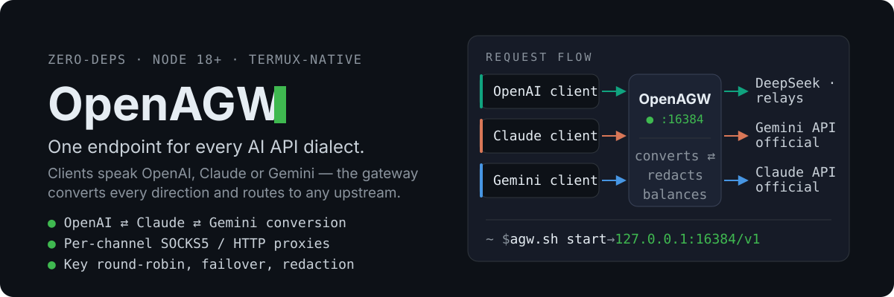

# OpenAGW — one endpoint for every AI API dialect

<p align="center">
  
</p>

A **zero-dependency** Node.js gateway (born on Termux, happy on any Linux / macOS box): accept requests from **any** AI client, serve them from **any** upstream — OpenAI, Claude, and Gemini formats are converted in every direction, streaming included. Outbound traffic can ride a per-channel **SOCKS5 / HTTP proxy**.

```text
Client (any dialect)                       Upstream (any dialect)
OpenAI ──┐                            ┌──▶  OpenAI official / DeepSeek / relays / llama.cpp
Claude ──┼──▶  OpenAGW :16384  ──────┼──▶  Gemini official
Gemini ──┘    convert ⇄ redact       └──▶  Claude official
              balance ⇄ proxy              direct, or per-channel SOCKS5 / HTTP proxy
```

- **Clients stay unchanged** — ChatBox, NextChat, Claude Code, and the OpenAI / Anthropic / Google SDKs all just point at the gateway.
- **Same format = byte-for-byte passthrough**; mixed formats get full conversion — streaming SSE, tool calls, images, thinking content, token accounting.
- **Keys stay flexible** — one model name on several channels: round-robin rotation, automatic failover on 429 / 401 / 5xx / connection errors, invisible switching.
- **Gateway-side parameter overrides** — `paramOverride` (instance or channel level) rewrites the request body on its way out, so a value you set in the gateway beats whatever the SDK client sent.
- **Zero npm dependencies** — if Node.js runs, it runs. No `npm install`, no build step.

## Proven, not promised

- **32 test suites · 847 assertions — all green.** Every suite is standalone: `node test/<name>_test.js`, no install, no build step.
- The full converter matrix (all 9 dialect pairs, streaming and not) plus proxy / auth / failover E2E pass in the maintainer's sandbox — **215/215**.
- Nothing to download for the gateway itself — the whole project is plain Node.js, so the test suite doubles as your smoke test.

## Quick start

Needs Node.js 18+. Install from a checkout:

```bash
git clone https://github.com/AndyerNotFound/OpenAGW.git ~/OpenAGW
cd ~/OpenAGW
cp data/config.example.json data/config.json   # then add one channel + its API key
bash agw.sh start
node agw.js web login        # panel one-time link (or `agw web login` after install)
```

…or one-shot (Termux / Linux / macOS):

```bash
curl -fsSL https://raw.githubusercontent.com/AndyerNotFound/OpenAGW/main/install.sh | bash
```

Smoke test:

```bash
curl http://127.0.0.1:16384/v1/chat/completions \
  -H "Content-Type: application/json" \
  -d '{"model":"deepseek-chat","messages":[{"role":"user","content":"hello"}]}'
```

## About OpenAGW

OpenAGW is the unified successor of two earlier projects by the same maintainer: the codebase comes from **ai-gateway-AI** (the actively developed gateway), with the traffic-distribution features of **ai-gateway-core** merged back in. Architecture, direction and acceptance testing are the maintainer's; implementation was assisted by AI coding tools.

What the merge adds, in user terms:

- **Pin one exact channel.** When the same model name is served by several channels (or instances), `/v1/models` additionally exposes one composite id per source, `instance:channel:model`. Requesting a composite id pins that exact channel — verified first, so the named channel must really serve the model; routing, billing and logs still use the real model name. Plain names keep working unchanged and still round-robin across every serving channel. Instance / channel segments match tolerantly (case, spaces and hyphens are interchangeable). Covered by `node test/modelref_test.js`.

## Speak any dialect

Point existing apps at the gateway — no code changes; whatever the client speaks reaches any upstream:

| Client speaks | Endpoint | Typical clients |
|---|---|---|
| OpenAI | `POST /v1/chat/completions` · `GET /v1/models` | ChatBox, NextChat, openai SDK, most "custom OpenAI" apps |
| Claude | `POST /v1/messages` | Claude Code, anthropic SDK |
| Gemini | `POST /v1beta/models/{model}:generateContent` (`:streamGenerateContent` for SSE) | Google AI SDKs |

`<host>` is the machine or phone running the gateway (`127.0.0.1` locally, its LAN IP for other devices — `ip -4 addr`). Every key belongs to exactly one role (user / admin); a user card is accepted anywhere a key belongs: `Authorization: Bearer`, `x-api-key`, `x-goog-api-key`, or `?key=`.

**The trailing `/v1` is optional.** A base URL that stops at the host — `http://<host>:16384` — reaches the same endpoints; the missing prefix is filled in before routing, so `POST /chat/completions`, `POST /messages`, `GET /models`, `POST /images/generations` all behave exactly like their `/v1/...` twins. The mirror mistake is covered too: a base URL that already ends in `/v1` plus a client that appends its own version (`/v1/v1/chat/completions`) is folded back to one segment.

Two limits keep this from widening the surface:

- **Only OpenAI-dialect endpoints are completed.** Closed prefixes (`/health`, `/status`, `/balance`, `/dashboard/...`, `/auth`, `/admin`) and the balance aliases keep returning 404 — completion cannot re-open a route the whitelist shut, and it never bypasses key auth.
- **An instance name always wins.** In multi-instance mode `/<instance>/chat/completions` works, but if an instance is literally named `chat`, `/chat/completions` means "instance `chat` + `/completions`". The panel therefore refuses to create or rename an instance to an endpoint name (`chat`, `models`, `images`, …); an instance that already carries one keeps working and logs a warning on load.

Covered by `node test/endpoint_completion_test.js`.

## Routing, conversion, balancing

```jsonc
// data/config.json (excerpt)
{
  "listen": { "host": "0.0.0.0", "port": 16384 },
  // keys are issued by the admin from the panel (user / admin roles); no master password
  "panel": { "openBrowser": true },      // agw web login: open the login link in a browser
  "proxies": {
    "clash": { "type": "socks5", "host": "127.0.0.1", "port": 7890 }
  },
  "channels": [
    { "name": "gemini-official", "type": "gemini",
      "baseUrl": "https://generativelanguage.googleapis.com",
      "apiKey": "AIza...", "proxy": "clash", "models": ["gemini-2.5-flash"] },
    { "name": "deepseek-key1", "type": "openai",
      "baseUrl": "https://api.deepseek.com",
      "apiKey": "sk-...", "models": ["deepseek-chat"], "default": true },
    { "name": "deepseek-key2", "type": "openai",
      "baseUrl": "https://api.deepseek.com",
      "apiKey": "sk-...", "models": ["deepseek-chat"] }
  ]
}
```

- **Model → channel**: exact hit in `modelMap` → the `models` list → the `default` channel → the first channel. `modelMap` renames too: `{"gpt-4o": "gemini-2.5-flash"}` serves a Gemini model to a GPT client.
- **Conversion covers streaming, tool calls, images, thinking content, and usage/token accounting.**
- **Parameters travel whole.** `temperature` / `top_p` / `max_tokens` / `stop` are translated per dialect; `top_k`, `seed`, penalties, `n`, `logit_bias`, `logprobs`, `response_format` / JSON schema, `reasoning_effort`, thinking budgets, `metadata`, `user`, `service_tier`, `store`, `safety_settings` and `parallel_tool_calls` are carried and written in the shape the target API expects. Anything the hub does not model rides in an `extra` bag and is re-merged verbatim when the channel speaks the client's dialect, so a same-dialect request reaches the upstream in its original shape — even with response redaction on. Usage comes back complete too: cached prompt tokens and reasoning tokens survive as `prompt_tokens_details` / `cache_read_input_tokens` / `cachedContentTokenCount` / `input_tokens_details`.
- **Same-format responses pass through byte-for-byte** (or are converted event-by-event); privacy filtering remains a separate, optional feature. A failing channel (429 / 401 / 500–504 / connection error) transparently retries on the next one; genuine client errors (`400`) come back as-is. Once a stream has started, the current channel is locked in.
- **Per-channel egress**: each channel can route through its own proxy (`"proxy": "clash"`), so Gemini / Claude can exit somewhere else than DeepSeek. `insecure: true` tolerates self-signed relays.

### Privacy filter

On by default for requests; `redact.response: true` also masks the response direction.

- **Content only.** It rewrites message text, system prompts, tool results and tool-call arguments. Protocol parameters are left alone: schemas (`tools`, `response_format`), `stop`, `metadata`, `user`, `id`s, image / file URLs and base64 payloads pass through untouched — a masked schema or URL is a broken request, not privacy. Numeric parameters whose name merely *contains* a sensitive word (`max_tokens`, `budget_tokens`, `max_output_tokens`) are never masked either.
- Masks values under sensitive fields (`api_key`, `token`, `password`, `authorization`, …) and pattern-matches built-ins: `sk-` keys, GitHub / Slack / AWS / Google / GitLab / HuggingFace tokens, `Bearer` headers, emails, mainland-China mobile numbers, national IDs, bank cards (Luhn-validated), private IPv4.
- **Streaming-safe**: SSE chunks are filtered so secrets split across fragments are still caught.
- **Fast path**: text without sensitive traits skips regex entirely; long contexts use a chunk-level cache that recomputes only changed parts.
- Custom rules: `redact.extra` regexes, editable in the panel, hot-reloaded.

## Managing the gateway

One process hosts every instance; create / rename / start / stop / edit instances hot from the panel — no restarts.

**Seamless restart.** `agw.sh start` runs a master process that owns the listening sockets plus one worker that serves traffic. `agw.sh restart` (also `reload`, or saving config in the panel) forks a replacement worker, waits until it is listening, then tells the old worker to stop accepting and drain; the old worker exits after its last in-flight response. New requests never fail and **in-flight streams are not cut** — the socket stays in the master, only the code is swapped. What still breaks is a worker that *crashes*: a socket cannot be moved between processes, so streams running at that instant die. Set `AGW_HOT=0` to run the old single-process mode.

```bash
bash agw.sh start | stop | restart | reload | status | list | logs | show
bash agw.sh config <instance> add | list | remove | set-port | set-key   # channels from the terminal

agw web login [--inst <instance>] [--open|--no-open]   # one-time panel login link
agw web [--inst <instance>]                            # session-id / token state
agw web --expired [--inst <instance>]                  # revoke all panel sessions
```

- **Web panel** — run `agw web login`; it prints `http(s)://<host>:<port>/auth/<session-id>/<token>`. The `session-id` is regenerated on every gateway start, and the `token` is regenerated by every login command, valid for 15 minutes and consumed on first use. Set `panel.openBrowser: false` to stop auto-opening the browser. Material 3 UI with a collapsible sidebar (a 56px icon rail that expands into a navigation drawer carrying the instance picker, refresh, password and theme), key cards, stats with switchable bar/line/pie charts, and a logs page that carries the request records. `/admin` is a plain 302 to `/auth` since the old inline page was removed. Optional Material You color bridge (`mduCmd` or `mdu.json` → `GET /admin/api/mdu`) to tint the panel like your phone.
- **Key cards** — issue prepaid card keys (generate / charge / ban, registration on/off) so other people can use a model without ever seeing a channel key; holders get self-service pages under `/auth`.
- **HTTPS without root** — `agw-tls setup` enables it in one shot; `agw-tls all` does the same for every instance. **One entry per instance, never a plaintext twin:** the main port serves HTTPS only on `listen.port`, and an instance with TLS on stops listening on its own port — it is reachable only via the main port's HTTPS at `/<instance>/`. A broken certificate fails closed rather than silently serving plaintext. Local private CA, per-device trust, automatic re-sign on IP change, <7-day certificate auto-renew and 90-day client-key rotation driven by `ops/guard.sh`. `agw-tls status` / `agw-tls use` for state and ready-made client snippets. `agw-tls export` drops the CA certificate into `/sdcard/Download/OpenAGW/` (with an install guide, auto-deleted after 30 minutes by default, `--keep 0` to keep); the private key is never exported.
- **Config encryption & portability** — encrypt config files at rest, export / import as JSON or QR code (`bash agw.sh config`).
- **Docker** — `docker compose up -d` (port 16384, state in the `ai-gateway-data` volume); panel link: `docker compose exec ai-gateway node /app/agw.js web login`.

### OpenAI extended endpoints (fixed behavior)

`POST /v1/responses` is always available — a full conversion endpoint (streaming, tool calls, reasoning) between Responses and Chat/Claude/Gemini bodies. Every other `/v1/*` path that is not a conversion entry or a gateway-local route is always forwarded verbatim to an OpenAI-type channel: `images`, `embeddings`, `audio/speech`, `audio/transcriptions`, `audio/translations`, `completions`, `moderations`, `files`, `batches`, `vector_stores`, …; method, path, query, multipart and binary bodies are preserved. Channel-level `useResponses: true` lets an OpenAI upstream speak the Responses API.

### Channel path lock

An optional channel-level `path` pins **all** requests on that channel to one exact upstream path:

```jsonc
{
  "name": "relay",
  "type": "openai",
  "baseUrl": "https://relay.example.com",
  "path": "/custom/v1/chat/completions"
}
```

- Upstream URL = `baseUrl + path`; the client path and query are ignored. This also applies to conversion requests.
- Omit `path` (or set it to `""`) for automatic behavior: conversion endpoints use their dialect-specific path, and non-conversion `/v1/*` requests pass through with the client path + query.
- `path` must start with `/`; a full URL is rejected. For Gemini streaming with a locked path, include any required query (for example `?alt=sse`) in `path` yourself.
- `path` only controls the URL. The request body dialect still follows the channel type, `useResponses`, and the client API (for example, a Responses client with a chat-locked path needs `useResponses: false` to send a chat body).

### Parameter override (`paramOverride`)

Parameters set in the gateway **beat the ones the SDK client sent** — they are not a fallback that only fills gaps. Two layers, channel-level wins over instance-level:

```jsonc
{
  "paramOverride": { "temperature": 0.6 },            // instance default, every channel
  "channels": [{
    "name": "deepseek", "type": "openai",
    "paramOverride": {
      "temperature": 1,
      "top_p": null,                                  // null = drop the parameter entirely
      "stop": ["END"],                                // arrays are replaced whole
      "metadata": { "from": "gateway" },              // objects merge key by key
      "thinking": { "type": "enabled", "budget_tokens": 2048 }
    }
  }]
}
```

- **Applied last.** The override is merged over the *final upstream body*, after dialect conversion, so it behaves identically on the byte-for-byte passthrough path and on a cross-format conversion — and it really overrides the client value (`temperature: 0.01` from the SDK is sent as `1`).
- **Write keys in the channel dialect** — `openai` / `claude` / `gemini` shape, e.g. `max_tokens` for OpenAI and Claude, `generationConfig.maxOutputTokens` for Gemini. One channel, one dialect, no guessing. An instance-level override applies to every channel, so keep it to keys all of your upstreams understand (or set it per channel).
- **Merge rules** — objects merge key by key, arrays and scalars replace, `null` deletes the key.
- **`model` and `stream` are off-limits.** The model comes from routing / `modelMap` / `models`, streaming from the client endpoint; an override on those two is ignored (logged once).
- **Chat endpoints only** — `/v1/chat/completions`, `/v1/messages`, `/v1/responses` (and their instance-prefixed forms). Extended endpoints (`images`, `embeddings`, `audio`, …) still forward untouched.
- **Config, not client data.** Override values are sent exactly as written; the privacy filter and `replace` rules apply to the incoming request, not to them.
- Editable in the panel (Routing → 参数覆写 for the instance; the channel dialog for a channel) or straight in `config.json`; saving hot-reloads the instance.

Covered by `node test/param_override_test.js`.

## Security notes

1. `0.0.0.0` + no key cards means anyone on the Wi-Fi can use the gateway (keyless mode). Issue key cards (user / admin roles) before LAN / internet exposure; use `127.0.0.1` for localhost-only.
2. Public paths are whitelisted: only `/v1`, `/v1beta`, `/auth`, `/profile`, and `/admin` exist — everything else 404s.
3. Config files hold your (optionally encrypted) upstream keys; do not share the directory. Runtime `data/.run/panel-*.json` holds only hashes, the session-id, and a local admin token (mode 0600).
4. Panel login always requires the one-time link; an empty `webToken` no longer makes the panel keyless over the network. `webToken` remains an optional long-lived API token for scripts.
5. Redaction is on by default; `redact.enable: false` turns it off for the instance, and a key card may additionally opt out with `redact=false`.

## Project layout

```text
OpenAGW/
├── gateway.js        # entry: master (owns the sockets) + worker (serves traffic)
├── hot.js            # hot restart: worker swap + in-flight drain
├── server.js …       # routing, conversion, balancing, redaction — one focused module each
├── sse.js            # spec-compliant SSE parser: LF/CRLF/CR, EOF flush, tolerant decoder
├── panel-auth.js     # panel session-id + one-time login token (file-based)
├── m3/               # web panel (Material 3, vanilla ESM, zero CDN)
├── agw.sh / agw-tls  # lifecycle + HTTPS management
├── data/             # config.json per instance, logs, pids
├── tls/  ops/        # private-CA scripts, renewal / rotation watchdog
└── test/             # sandbox test suite
```

## Testing

Every suite runs anywhere — no npm install, no build step:

| Suite | Assertions | Covers |
|---|---|---|
| `test/admin_guard_test.js` | 17 | admin surface guarded: /admin redirect only, panel auth, static extension whitelist, no hints on 401 |
| `test/balance_test.js` | 77 | balance passthrough + routing |
| `test/breaker_test.js` | 6 | channel circuit breaker |
| `test/endpoint_completion_test.js` | 122 | bare base URL (no `/v1`), doubled-prefix folding, closed prefixes stay closed, auth not bypassed |
| `test/hot_pool_test.js` | 7 | hot restart across instance ports |
| `test/hot_restart_test.js` | 9 | worker swap with an in-flight SSE stream |
| `test/key_roles_test.js` | 23 | one-key-one-role card semantics |
| `test/log_memory_test.js` | 13 | log tail read is bounded by a window, not by file size; rotation keeps a sane size |
| `test/mixed_modelmap_test.js` | 3 | modelMap + models list on one channel |
| `test/modelref_test.js` | 20 | composite `instance:channel:model` routing |
| `test/no_multiuser_test.js` | 20 | single-tenant behavior (accounts removed, card keys kept) |
| `test/panel_auth_test.js` | 31 | one-time link, session rotation, API auth |
| `test/param_e2e_test.js` | 20 | same-dialect request reaches upstream verbatim while responses are masked |
| `test/param_passthrough_test.js` | 117 | request/response parameter fidelity + redaction scope |
| `test/path_lock_test.js` | 16 | channel `path` lock + fixed passthrough |
| `test/plugin_protocol_test.js` | 83 | plugin manifest / signature / dispatch guards |
| `test/plugins_e2e_test.js` | 23 | plugins over real HTTP |
| `test/plugins_migrated_test.js` | 18 | migrated balance / probe / legacy-import plugins |
| `test/random_route_test.js` | 4 | opt-in random routing (order-based, not a 7%-flaky split check) |
| `test/record_memory_test.js` | 20 | request-record buffer stops at maxChars; upstream error bodies are capped |
| `test/redact_test.js` | 40 | redaction cases |
| `test/session_persist_test.js` | 6 | panel session persistence |
| `test/sse_backpressure_test.js` | 4 | a long SSE stream survives write backpressure (regression: 382 KB then silence) |
| `test/sse_line_cap_test.js` | 11 | a newline-free SSE line cannot grow without bound |
| `test/sse_convert_test.js` | 16 | cross-format SSE + response redaction across fragments |
| `test/sse_stream_test.js` | 39 | one-byte SSE fragments, CRLF/CR, EOF, whitespace-only deltas |
| `test/stats_all_test.js` | 8 | aggregate instance / model / channel stats |
| `test/sticky_test.js` | 7 | sticky routing keeps the prompt cache warm |
| `test/tls_fail_closed_test.js` | 4 | TLS fails closed on broken certs |
| `test/tls_single_entry_test.js` | 7 | TLS single entry — never a plaintext twin |
| `test/utf8_split_test.js` | 4 | chunk-split decoding |

**795 assertions, 0 failures** — measured on Node `v24.22.2` (Termux). The full converter matrix (all 9 dialect pairs, streaming and not) and proxy / auth / failover E2E run in the maintainer's sandbox — 215/215.

## License

[AGPL-3.0](LICENSE). Network-service use also requires offering the source to users.
